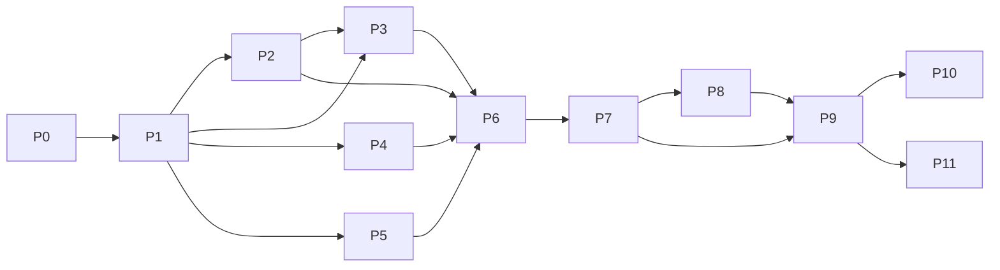

# Plan de développement par phases : THE LAST LIGHT (Space Mission Design Game)

*Découpage du projet en phases, avec périmètre, fonctionnalités, ressources NASA à utiliser, checklist de tests et critères d'acceptation.*

- **Sources du projet** : cahier d'analyse v1.2, cahier de conception v1.1, `Agent.md` (backend), énoncé du défi NASA Space Apps « Space Mission Design Game » et onglet *Resources*.
- **Date de rédaction et de consultation des sources web** : 14 novembre 2026.
- **Ordre de priorité des sources du projet** (repris de `Agent.md` §0) : cahier d'analyse > cahier de conception > `Agent.md`. En cas de conflit ou de trou : on ne tranche pas, on écrit la question dans `docs/QUESTIONS.md` et on continue avec l'hypothèse la plus prudente, marquée `// HYPOTHESE`.

---

## 0. Comment lire ce document

### 0.1 Structure d'une phase

Chaque phase contient les mêmes cinq blocs : **Périmètre** (inclus / exclu), **Fonctionnalités**, **Ressources NASA à utiliser** (avec le livrable concret que chaque ressource produit), **Checklist de tests et critères d'acceptation**, **Terminé quand**.

### 0.2 Convention des identifiants de test

`T<phase>-<numéro>` (ex. `T3-07`). Le type de test est indiqué : **U** unitaire, **C** contrat, **P** propriété (test avec entrées aléatoires), **I** intégration, **E** bout en bout, **M** revue manuelle, **R** test de référence contre une valeur externe.

### 0.3 Niveau de fiabilité des sources

| Marque | Signification |
|---|---|
| **[P]** | Source primaire NASA (page ou document NASA, NTRS, NSSDC, JPL, GMAT) |
| **[S]** | Source secondaire qui relaie des chiffres NASA : à **recouper** avec le document NASA avant de les figer dans le catalogue |
| **[R]** | Ressource fournie par l'onglet *Resources* du défi (utilisée telle que décrite, sans URL connue de ma part) |
| **[?]** | À rechercher : aucune source vérifiée à ce jour |

Règle `Agent.md` §0.2 : toute valeur du catalogue sans source est marquée `"source": "a-calibrer"`. Rien dans ce plan n'est une donnée « inventée » : les valeurs réelles citées viennent des sources listées en annexe A, les valeurs calculées viennent de formules du cahier de conception et sont reproductibles (annexe B).

### 0.4 Cartographie des phases et des étapes de `Agent.md` §16

| Phase | Titre | Étape `Agent.md` | Version | Domaines |
|---|---|---|---|---|
| P0 | Cadrage, outillage et registre des sources | (préalable) | MVP | transverse |
| P1 | Noyau : kernel, contrats, physique, squelette serveur | 1 | MVP | kernel, contracts, physics, apps/server |
| P2 | Catalogue et scénarios | 2 | MVP | CAT, SCE |
| P3 | Conception de mission | 3 | MVP | CON |
| P4 | Simulation et opérations | 4 | MVP | SIM |
| P5 | Évaluation et rapport | 4 | MVP | EVA |
| P6 | Campagne, pédagogie, identité | 5 | MVP | CAM, PED, IDE |
| P7 | API complète et vue de mission | 6 | MVP | tous (API) |
| P8 | Présentation : écrans et scène 3D | hors `Agent.md` (cahier de conception §4.2, §6.3, §6.4) | MVP | présentation |
| P9 | Intégration, qualité, sécurité, déploiement | (transverse) | MVP | tous |
| P10 | Coopération à quatre | 7 | V2 | EQU |
| P11 | Classement, partage, bac à sable, scénarios additionnels | 8 | V3 | CLA, CON, SIM, SCE |

`Agent.md` est limité au backend : la phase **P8** couvre la couche de présentation décrite dans le cahier de conception (React, Three.js, thème « Orbita ») pour que le plan couvre bien tout le projet.

### 0.5 Graphe de dépendances



Une fois les contrats gelés (fin de P1), **P2, P3 (en partie), P4 et P5 peuvent se mener en parallèle** (`Agent.md` §16). P3 a besoin d'un catalogue minimal de P2 : utiliser un catalogue simulé (RI5) tant que P2 n'est pas livrée.

### 0.6 Correspondance actes du jeu et cycle de vie NASA (proposition)

Pour utiliser concrètement le *NASA Systems Engineering Handbook* et la ressource *Design and Develop Science Missions*, je propose de caler les sept actes sur les phases du cycle de vie NASA. C'est une **proposition** (à valider, voir Q-12) : elle ne change aucun contrat.

| Acte du jeu | Phase du cycle de vie NASA (handbook SP-2016-6105 Rev2) | Segment de mission (ressource *Design and Develop Science Missions*) |
|---|---|---|
| 0 · The Last Transmission | Pré-phase A : études de concept | Besoin scientifique initial |
| I · A Promise That Must Live | Phase A : concept et développement technologique | Besoin scientifique vers exigences (segment utilisateurs) |
| II · Every Gram Has a Price | Phase B : conception préliminaire | Segment spatial (orbiteur, instruments) |
| III · The Point of No Return | Phases C et D : conception finale, intégration, essais, lancement | Segments lancement et sol |
| IV · Alone Above the Moon | Phase E : opérations et soutien | Segments spatial et sol en opération |
| V · The Last Light | Phase E : opérations (anomalie) | Segments spatial et sol |
| VI · What We Leave Behind | Phase F : clôture | Segment utilisateurs (analyse et usage des données) |

---

## 1. Socle de données NASA : ce que le projet utilise vraiment

Cette section est le **point d'entrée** pour le catalogue (P2), la physique (P1), la simulation (P4) et le rapport (P5). Elle fusionne les ressources de l'onglet *Resources* du défi et des compléments que j'ai vérifiés en ligne. Les liens et le niveau de fiabilité de chaque source sont en annexe A.

### 1.1 Constantes du corps central (scénario lunaire)

| Grandeur | Valeur | Source | Usage |
|---|---|---|---|
| Rayon moyen volumétrique de la Lune | 1 737,1 km (équatorial 1 738,1 km) | NSSDC *Moon Fact Sheet* [P] | `physics` : rayon `R` des formules A3 et A4 |
| Masse de la Lune | 0,07346 × 10²⁴ kg | NSSDC *Moon Fact Sheet* [P] | contrôle croisé de `μ` |
| Paramètre gravitationnel `μ` | 4 902,8 km³/s² (valeur courante, **à relire dans GMAT/SPICE**) | À confirmer dans GMAT (`a-calibrer` tant que non confirmé) | `physics` : période orbitale |
| Contrôle de cohérence | G × M (avec la masse de la fiche NSSDC) donne 4 902,94 km³/s² : écart de 0,003 % avec 4 902,8 | calcul (annexe B) | test `T1-04` |

La formule A3 du cahier de conception écrit `R_terre = 6371 km` dans un commentaire : pour ce scénario, `physics` doit recevoir le **corps central en paramètre** (Lune ici, Terre pour d'éventuels scénarios futurs).

### 1.2 Mission de référence : Lunar Reconnaissance Orbiter (LRO)

LRO est le meilleur point d'appui réel pour le scénario (orbiteur robotique, orbite polaire basse, recherche d'eau, mêmes catégories d'instruments que le catalogue d'`Agent.md` §9).

| Élément | Valeur de référence | Source | Statut |
|---|---|---|---|
| Masse au lancement / à sec / ergols | 1 916 kg / 1 018 kg / 898 kg | Spaceflight Now (dossier de presse NASA relayé) | **[S]** à recouper |
| Puissance | 685 W (Spaceflight Now) ; 824 W moyenne, 1,5 kW crête (eoPortal) : **sources divergentes** | **[S]** | `a-calibrer` |
| Orbite de cartographie | quasi circulaire polaire, ~50 km, période ~2 h ; environ 6 passes par jour d'environ 1 h avec l'antenne de 18 m de White Sands | JPL IPN Progress Report 42-222B | **[P]** |
| Liaison de données | bande K/Ka à 100 Mbit/s (émetteur 40 W, antenne de 75 cm, 25,65 GHz) ; bande S pour les données d'ingénierie | JPL IPN 42-222B ; catalogue PDS de LOLA | **[P]** |
| Volume de données par jour | 461 Gbit/jour (Spaceflight Now) ; 572 Gbit/jour (eoPortal) : **divergence** | **[S]** | `a-calibrer` |
| Stockage embarqué | deux enregistreurs de 100 Go | catalogue PDS (LOLA) | **[P]** |
| Instruments | voir 1.3 | | |

**Anomalie réelle utilisable comme inspiration d'événement** : l'émetteur radar Mini-RF de LRO a subi une anomalie en janvier 2011 qui a suspendu ses opérations normales (Wikipedia, **[S]** : retrouver le communiqué NASA avant de s'en servir). Cela justifie qu'un instrument tombe en panne sans cause humaine, ce qui respecte RG5.

### 1.3 Instruments : valeurs réelles de référence et correspondance avec le catalogue

Les valeurs ci-dessous sont des **références réelles** (masse et puissance moyenne) pour calibrer des paramètres de **gameplay** (RG12). Elles proviennent de Spaceflight Now (relais du dossier de presse NASA) : **[S]**, à recouper avec la page NASA LRO (`science.nasa.gov/mission/lro/spacecraft-and-instruments/`) avant import.

| Famille du catalogue (`Agent.md` §9) | Instrument réel de référence | Masse réelle | Puissance moyenne réelle | Rôle scientifique (source NASA/USGS) |
|---|---|---|---|---|
| Caméra haute résolution | LROC (caméras à angle étroit et grand angle) | 19,2 kg | 24,0 W | images jusqu'à 50 cm/pixel (USGS) ; la caméra grand angle donne 100 m/pixel sur 60 km de large |
| Spectromètre neutronique | LEND (détecteur de neutrons) | 25,8 kg | 11,6 W | cartographie de l'hydrogène du sol, indice de glace d'eau |
| Imageur thermique | Diviner (radiomètre) | 11,0 kg | 24,7 W | émission thermique de la surface, zones froides |
| Radar | Mini-RF (radar à synthèse d'ouverture) | 13,8 kg | 7,0 W | recherche de glace, rugosité (démonstration technologique) |
| *(famille à décider, Q-07)* altimètre | LOLA | 11,3 kg | 33,4 W | topographie et pentes |
| *(hors catalogue, pour des événements)* radiation | CRaTER | 5,4 kg | 7,3 W | effets des rayons cosmiques |

Les valeurs de l'exemple d'analyse (spectromètre neutronique de 14 kg / 22 W, caméra de 18 kg / 30 W, orbiteur de 310 kg) **diffèrent** des valeurs réelles ci-dessus. Ce n'est pas un défaut tant qu'elles restent marquées `a-calibrer` ; il faut en revanche décider (Q-06) si le catalogue prend les valeurs réelles ou des valeurs de jeu proportionnées à un orbiteur plus petit.

**Structure de catalogue proposée** pour garder le réel et le jeu séparés :

```json
{
  "id": "instr-camera-hr",
  "gameplay": { "massKg": 18, "powerW": 30, "dataMbps": 40, "scienceValue": 0.0, "source": "a-calibrer" },
  "reference": {
    "mission": "LRO", "instrument": "LROC",
    "massKg": 19.2, "powerW": 24.0,
    "source": "Spaceflight Now (relais dossier de presse NASA)",
    "urlSource": "https://spaceflightnow.com/atlas/av020/090610lro.html"
  },
  "missionsReelles": ["LRO"]
}
```

Le champ `missionsReelles` (idée reprise du jeu *A Learning Game About Telescopes*) n'est rempli **que** depuis des données sourcées (`Agent.md` §7).

### 1.4 Science du scénario : ce que les missions réelles ont trouvé

Pour les archives, le briefing et les fins du paquet de scénario (domaine SCE), tout fait réel doit porter un champ `source` :

| Fait réel | Source | Usage narratif |
|---|---|---|
| Le spectromètre à neutrons de Lunar Prospector (1998) a montré un excès d'hydrogène aux deux pôles, dans les cratères en ombre permanente. Annonce de baisses de 3,4 % (nord) et 2,2 % (sud) dans les rapports de neutrons | NSSDC *Lunar Prospector Science Results* et *Ice on the Moon* [P] ; Scientific American [S] pour les pourcentages | justifie l'objectif principal « recherche de glace d'eau » et l'instrument « spectromètre neutronique » |
| Lunar Prospector a été volontairement écrasé près du pôle sud en 1999 ; aucun signal d'eau n'a été détecté depuis la Terre | Britannica [S] ; NSSDC [P] | archive du passé, « l'échec utile » |
| LCROSS (mission à 79 M$) a cherché de la glace en frappant un cratère polaire ; ses instruments ont détecté des indices d'eau | Spaceflight Now [S], résultats de novembre 2009 | ordre de grandeur du **budget** (le budget de 100 M$ du scénario est cohérent) ; lien avec la mission perdue LUNAR-01 (fictive) |
| L'hydrogène détecté ne dit pas sous quelle forme il se trouve (glace, hydrates, vent solaire) | NSSDC [P] ; Universe Today [S] | mécanique de **fin** : la science ne prouve pas toujours ce qu'on espère |

**LUNAR-01 et les personnages sont fictifs** : le paquet de scénario doit les marquer `fiction: true` pour ne jamais les confondre avec ces missions réelles.

### 1.5 Réseau sol

| Élément | Source | Usage |
|---|---|---|
| Station de 18 m de White Sands (Ka et S) pour LRO | JPL IPN 42-222B [P] | `StationSol` du catalogue |
| Sites lunaires du réseau (LEGS) : White Sands, Matjiesfontein (Afrique du Sud), Alice Springs (Australie) | NTRS « Ka One Network Evolution » (20240012036) [P] | `StationSol` ; un site africain est cohérent avec le contexte sociétal du cahier d'analyse |
| Réseaux Near Space Network et Deep Space Network | NTRS 20250005602 [P] | vocabulaire de la phase P2 et glossaire |

### 1.6 Lanceurs

La page de performance du *NASA Launch Services Program* (`elvperf.ksc.nasa.gov`) donne des estimations de capacité par orbite pour les lanceurs sous contrat NASA. **À utiliser hors ligne, à la main**, pour renseigner `capaciteKg` par classe (léger, moyen, lourd). Attention : la page affiche un bandeau indiquant qu'elle n'est pas mise à jour pendant la période d'interruption de financement fédéral ; noter la date de consultation. Tant que ce n'est pas fait, les capacités restent `a-calibrer`. **Ne pas nommer de lanceurs réels** sans valeur relevée (`Agent.md` §0.2).

### 1.7 Outils de référence hors ligne

| Outil | Rôle dans le projet | Contrainte |
|---|---|---|
| **GMAT R2025a** (open source, NASA GSFC, référence GSC-19468-1, Windows/Linux/macOS) | produire des valeurs de référence (période, éclipse, passages, propagation à deux corps) pour les tests `R` de `physics` ; le produit GMAT a servi à des analyses de LCROSS, ARTEMIS et LRO | **jamais** intégré au serveur ni appelé en jeu. Vérifier s'il existe une version plus récente que R2025a avant de figer la référence |
| **NASA's Eyes on the Solar System** (web) | référence d'expérience pour la vue de mission (voir P7, P8) | pas une source de données pour le jeu |
| **gmat-run** (paquet Python tiers, licence MIT) | exécuter des scripts GMAT en ligne de commande pour générer les références dans la CI hors ligne | optionnel ; outil de développement uniquement |

---

## Phase P0 : Cadrage, outillage et registre des sources

**Version** : MVP · **Dépend de** : rien · **Jalon** : dépôt prêt, règles de frontière actives, sources enregistrées.

### Périmètre

- **Inclus** : monorepo pnpm, TypeScript strict, ESLint, Prettier, Vitest, `dependency-cruiser`, CI, scripts portables Windows, Docker Desktop avec PostgreSQL (dix schémas), `docs/QUESTIONS.md`, registre `docs/nasa/SOURCES.md`, gabarit de `README.md` par domaine.
- **Exclu** : tout code métier.

### Fonctionnalités

| ID | Fonctionnalité | Réf. |
|---|---|---|
| F0.1 | Monorepo `packages/` et `apps/` selon `Agent.md` §3 | |
| F0.2 | Règles de frontière RI1 à RI7 exprimées en règles `dependency-cruiser` (tableau des dépendances autorisées, interdiction de `@nestjs/*` dans `domain/` et dans les paquets purs) | RI1-RI7, `Agent.md` §18 |
| F0.3 | CI : build, lint, types, tests, frontières | |
| F0.4 | `docs/QUESTIONS.md` initialisé avec les 9 points ouverts d'`Agent.md` §17 et les questions Q-01 à Q-14 de la section 5 de ce document | `Agent.md` §0.1 |
| F0.5 | `docs/nasa/SOURCES.md` : une ligne par source (URL, date de consultation, statut [P]/[S]/[R]/[?], usage, personne qui a vérifié) | `Agent.md` §7, §9 |
| F0.6 | `docker-compose` PostgreSQL avec schémas `ide`, `cat`, `sce`, `con`, `sim`, `eva`, `cam`, `equ`, `ped`, `cla` | `Agent.md` §10 |
| F0.7 | Conventions Git : commits conventionnels, une branche par fonctionnalité, revue avant fusion | `Agent.md` §15 |

### Ressources NASA à utiliser

| Ressource | Usage concret | Livrable |
|---|---|---|
| *NASA Systems Engineering Handbook* (SP-2016-6105 Rev2) [P] | emprunter les **noms de revues et de portes** (revue de concept, de conception préliminaire, de conception critique, de préparation opérationnelle) pour nommer nos jalons de phase | glossaire des jalons dans `docs/jalons.md` |
| *CubeSat 101* [P] | s'inspirer de ses **listes de contrôle d'acceptation** pour le format de notre checklist de phase | gabarit `docs/checklist-phase.md` |
| GMAT R2025a [P] | installer et **figer la version** utilisée pour les références ; consigner constantes de la Lune lues dans GMAT | `docs/nasa/gmat-version.md` |
| Annexe A de ce document | amorcer le registre des sources | `docs/nasa/SOURCES.md` |

### Checklist de tests et critères d'acceptation

| ID | Type | Test | Critère d'acceptation |
|---|---|---|---|
| T0-01 | I | `pnpm install` puis `pnpm -r build` sur un poste Windows propre | code de sortie 0, aucun script `bash` seul requis |
| T0-02 | I | `dependency-cruiser` sur la base de code vierge | 0 violation |
| T0-03 | I | Ajouter volontairement un import de `simulation` dans `conception` | la CI échoue et le message nomme la règle violée |
| T0-04 | I | Ajouter un import `@nestjs/common` dans un fichier `domain/` | le lint échoue |
| T0-05 | I | `docker compose up` puis lister les schémas de la base | exactement 10 schémas : `ide, cat, sce, con, sim, eva, cam, equ, ped, cla` |
| T0-06 | M | Relire `docs/QUESTIONS.md` | contient les 9 points d'`Agent.md` §17 et Q-01 à Q-14, chacun avec une hypothèse provisoire |
| T0-07 | M | Relire `docs/nasa/SOURCES.md` | 100 % des lignes ont URL, date de consultation, statut et usage ; aucune ligne sans statut |
| T0-08 | I | Exécuter les scripts du dépôt sous PowerShell et `cmd` | tous passent sans chemins codés en dur |

### Terminé quand

CI verte sur la base vierge ; règles de frontière prouvées par un test qui échoue volontairement ; registre des sources et questions ouvertes versionnés.

---

## Phase P1 : Noyau, contrats, physique et squelette serveur

**Version** : MVP · **Domaines** : `kernel`, `contracts`, `physics`, `apps/server` · **Dépend de** : P0 · **Jalon** : contrats C1 à C9 **gelés** avec tests ; formules A3 et A4 testées.

### Périmètre

- **Inclus** : types communs et unités, contrats C1 à C9 (types TypeScript + schémas Zod + champ `version` + jetons de ports), fonctions pures de `physics`, générateur `mulberry32`, squelette NestJS (`AppModule`, `ZodValidationPipe`, filtre d'exceptions `{ code, params, statut }`, `ConfigModule` validé par Zod, OpenAPI, bus d'événements en mémoire).
- **Exclu** : tout domaine métier, base de données, authentification.

### Fonctionnalités

| ID | Fonctionnalité | Réf. |
|---|---|---|
| F1.1 | Contrats C1 à C9 avec schémas Zod, version, et jetons `CONCEPTION_PORT`, `SIMULATION_PORT`, `EVALUATION_PORT`, `EVENT_BUS` | C1-C9, RI3 |
| F1.2 | Tests de contrat : le producteur respecte le schéma, chaque consommateur sait le lire | `Agent.md` §14 |
| F1.3 | `physics.periode(corps, altitude)` | A3 |
| F1.4 | `physics.eclipse(corps, altitude, fractionEclipse)` et `capaciteBatterieMin(...)` | A3 |
| F1.5 | `physics.contactSol(...)` tel que spécifié dans A4 (voir Q-01 : à ne pas corriger sans décision) | A4 |
| F1.6 | `physics.tsiolkovski(masseSecheKg, deltaV, isp, marge)` | A1 |
| F1.7 | Constantes par corps central (Lune) avec source | §1.1 |
| F1.8 | `mulberry32(graine)` dans `@smdg/kernel` (`// HYPOTHESE` : l'emplacement n'est pas fixé par la documentation) | A6, RG3 |
| F1.9 | `AppModule` : pipe Zod, filtre global d'exceptions, configuration validée, OpenAPI, `EVENT_BUS` branché sur `@nestjs/event-emitter` | `Agent.md` §3.3 |

### Ressources NASA à utiliser

| Ressource | Usage concret | Livrable |
|---|---|---|
| NSSDC *Moon Fact Sheet* [P] | fournir rayon et masse de la Lune ; recouper `μ` | `physics/src/corps/lune.ts` avec `source` et `urlSource` |
| **GMAT** [P] | script GMAT d'une orbite lunaire circulaire à 50, 100 et 200 km : période, durée d'éclipse, position après un tour | fichiers de référence `physics/test/reference/gmat/*.json` + le script GMAT versionné |
| JPL IPN 42-222B [P] | contrôle de vraisemblance : à ~50 km, LRO a une période d'environ 2 h | test `T1-05` |
| Mission *Design and Develop Science Missions* [R] | vocabulaire des quatre segments pour nommer les modules `physics` (lancement, spatial, sol, utilisateurs) sans en ajouter d'autres | notes dans le `README.md` de `physics` |

### Checklist de tests et critères d'acceptation

| ID | Type | Test | Critère d'acceptation |
|---|---|---|---|
| T1-01 | C | Chaque contrat C1 à C9 | porte un champ `version` ; une instance valide passe le schéma ; une instance à champ manquant échoue avec le **chemin** du champ |
| T1-02 | C | Pour chaque contrat : exemple producteur lu par chaque consommateur déclaré | 100 % des paires producteur/consommateur du tableau §4 d'`Agent.md` passent |
| T1-03 | C | Modifier un champ d'un contrat sans changer sa version | le test d'instantané du schéma échoue |
| T1-04 | R | `μ` de la constante vs G × M de la fiche NSSDC | écart ≤ 0,05 % (valeur calculée : 0,003 %) |
| T1-05 | R | `periode(Lune, 50 km)` | entre 105 et 125 min (valeur calculée : 113,0 min), cohérent avec « ~2 h » de LRO |
| T1-06 | R | `periode(Lune, 100 km)` vs valeur de référence | 7 065,7 s ± 0,5 % pour R = 1 737,1 km ; plus tard ≤ tolérance GMAT fixée en Q-05 |
| T1-07 | U | Fraction d'éclipse **géométrique maximale** (soleil dans le plan orbital) | 0,3945 ± 0,002 à 100 km (46,5 min ± 0,2) ; 0,4245 à 50 km (48,0 min) |
| T1-08 | U | `capaciteBatterieMin` avec 96 W, fractionEclipse 0,35, T à 100 km, profondeur de décharge 0,5, η 0,9 (**valeurs de test**, pas du catalogue) | 146,5 Wh ± 0,1 |
| T1-09 | U | `contactSol` avec ε = 10° à 100 km | λ = 11,38° ± 0,01 ; contact max 7,44 min ± 0,02 ; contact moyen (× 0,6) 4,47 min ± 0,02 (conforme à A4 tel qu'écrit) |
| T1-10 | M | Question Q-01 enregistrée | `QUESTIONS.md` cite l'écart A4 vs LRO (4,3 min calculées vs ~6 passes d'~1 h par jour) |
| T1-11 | U | `tsiolkovski(200 kg, 1000 m/s, Isp 300 s, marge 0)` | 80,96 kg ± 0,01 ; Δv = 0 donne 0 ; croissant en `margeDv` |
| T1-12 | U | `mulberry32` | même graine donne les mêmes 1 000 premières valeurs ; graines différentes donnent des suites différentes ; toutes dans [0 ; 1[ |
| T1-13 | I | Lint des paquets purs | aucune occurrence de `Math.random`, `Date.now`, `fetch`, `@nestjs/*` dans `kernel`, `contracts`, `physics` |
| T1-14 | I | `GET /api/health` et document OpenAPI | 200 ; l'OpenAPI généré est valide (OpenAPI 3) |
| T1-15 | I | Corps de requête invalide sur une route d'essai | réponse `{ code, params, statut: 400 }` |
| T1-16 | I | Démarrer sans une variable d'environnement obligatoire | échec au démarrage avec le nom de la variable manquante |
| T1-17 | I | `EVENT_BUS` : publier un événement typé | l'abonné le reçoit ; une charge utile invalide est refusée |

### Terminé quand

Contrats C1 à C9 gelés et versionnés ; formules A3 et A4 vertes ; `AppModule` démarre avec pipe, filtre, configuration et OpenAPI ; aucune frontière violée.

---

## Phase P2 : Catalogue et scénarios

**Version** : MVP · **Domaines** : CAT, SCE · **Dépend de** : P1 · **Jalon** : JSON du catalogue et du scénario lunaire importés ; A11 passe.

### Périmètre

- **Inclus** : schéma JSON du catalogue (composants, instruments, orbites, lanceurs, stations sol, seuils), import validé et versionné, lecture C1, paquet de scénario lunaire (7 actes, 4 fins avec règles à valeurs d'exemple, événements avec indices, objectifs, conditions de déblocage, textes fr/en), **second scénario court** pour tester le déblocage, validation A11, routes d'administration.
- **Exclu** : valeurs de lanceurs réels non relevées ; scénario CubeSat (interdit au MVP, `Agent.md` §7) ; code du jeu.

### Fonctionnalités

| ID | Fonctionnalité | Réf. |
|---|---|---|
| F2.1 | Schéma du catalogue avec bloc `gameplay` et bloc `reference` (§1.3) ; champs `source`, `urlSource`, `missionsReelles` | RG12, BF36 |
| F2.2 | Import du catalogue : validation Zod, chargement en base (`cat`), idempotent, versions conservées lisibles | BF36 |
| F2.3 | Lecture C1 par version | C1 |
| F2.4 | Catalogue lunaire : structure, énergie (panneaux, batteries), communications, ordinateur de bord, attitude, propulsion, 4 instruments, 3 lanceurs, 3 orbites (polaire circulaire, circulaire basse, elliptique), stations sol | `Agent.md` §9 |
| F2.5 | Niveaux de catalogue : composants « simples » (Découverte) et « avancés » (Ingénieur, Expert) | défi, BF35 |
| F2.6 | Paquet de scénario lunaire : cible, budget, objectifs, catalogue autorisé, 7 actes, définitions d'événements avec `indice`, 4 fins avec règles, conditions de déblocage, version | C2, RG6, RG9 |
| F2.7 | Conséquences d'événements **typées** : `instrument`, `donnees`, `objectif` ou `dureeVie`, jamais autre chose | RG5 |
| F2.8 | Narration fr/en dans le paquet ; faits réels balisés `realFact: true` avec `source` ; éléments fictifs balisés `fiction: true` | RI7, §1.4 |
| F2.9 | Validation d'import A11 | A11 |
| F2.10 | Routes d'administration (catalogue, scénarios) réservées au rôle administrateur | `Agent.md` §11 |
| F2.11 | Second scénario court pour tester le mécanisme de déblocage (condition par défaut : prérequis terminé avec fin A, B ou C) | RG9, analyse §2.1 |

### Ressources NASA à utiliser

| Ressource | Usage concret | Livrable |
|---|---|---|
| LRO : masses et puissances des instruments (§1.3) [S] à recouper avec [P] | blocs `reference` des 4 familles d'instruments (et de l'altimètre si Q-07 l'accepte) | `catalogue/data/instruments.json` |
| Page NASA LRO + USGS Astrogeology [P] | résolution des caméras et rôle de chaque instrument pour les textes `pedagogie` | champ `roleScientifique` fr/en |
| Lunar Prospector, LCROSS (§1.4) [P]/[S] | archives, objectifs scientifiques, ordre de grandeur du budget (LCROSS 79 M$) | `scenarios/lune-polaire/archives.json` |
| NASA Launch Services Program (performance) [P] | capacités par classe de lanceur et par orbite, relevées à la main | `catalogue/data/lanceurs.json`, sinon `a-calibrer` |
| NTRS (LEGS, NSN) [P] | stations sol, dont un site africain | `catalogue/data/stations.json` |
| *Design and Develop Science Missions* [R] | structurer le catalogue selon les 4 segments : lanceur (lancement), orbiteur et instruments (spatial), stations (sol), résultats (utilisateurs) | table des catégories du catalogue |
| *Mission Design Lab* [R] | disciplines à couvrir (puissance, propulsion, structures, avionique, communications, contrôle d'attitude, logiciel, fiabilité, coût, risque) ; **thermique absente de l'analyse** : voir Q-04 | grille de couverture des catégories |
| *CubeSat 101* + *State-of-the-Art Small Spacecraft Technology* [P] | familles de composants « simples » du niveau Découverte ; l'orbiteur de 310 kg dépasse la définition d'un petit satellite (moins de 180 kg dans le rapport) : ce rapport sert pour les **composants**, pas pour la masse totale | `catalogue/data/composants-simples.json` |
| *A Learning Game About Telescopes* [R] | `missionsReelles` et indices de compatibilité (options indisponibles) | champs `missionsReelles` et `incompatiblesAvec` |

### Checklist de tests et critères d'acceptation

| ID | Type | Test | Critère d'acceptation |
|---|---|---|---|
| T2-01 | U | Valider tous les JSON du catalogue contre le schéma | 100 % valides ; un élément sans `source` ni `"a-calibrer"` fait échouer l'import |
| T2-02 | U | Valeur avec `source` autre que `a-calibrer` | porte un `urlSource` en `https` ; la liste des domaines acceptés est configurable |
| T2-03 | M | Relecture humaine des URL | 100 % des `urlSource` ouvrent la page citée à la date de consultation ; le résultat est noté dans `SOURCES.md` |
| T2-04 | I | Importer deux fois la même version | aucun doublon en base ; importer une nouvelle version laisse l'ancienne lisible via C1 |
| T2-05 | U | Écart entre `gameplay` et `reference` des instruments | rapport masse et puissance de jeu / réelle compris entre 0,3 et 3 (à valider, Q-06) |
| T2-06 | U | Période de chaque orbite du catalogue | égale à `physics.periode` à 0,1 % près |
| T2-07 | U | `fractionOmbre` de chaque orbite | ≤ fraction géométrique maximale pour son altitude (ex. ≤ 0,3945 à 100 km) ; l'exemple d'analyse (0,35) passe |
| T2-08 | U | Capacités de lanceur | chaque lanceur déclare les orbites **accessibles** ; une orbite absente rend possible le code `ORBITE_INACCESSIBLE` (A2) |
| T2-09 | U | A11 : paquet valide | passe sans erreur |
| T2-10 | U | A11 : paquets invalides (6 actes ; 3 fins ; fin inatteignable ; identifiant de catalogue inconnu ; conditions de déblocage cycliques) | chaque défaut produit une erreur identifiable ; **toutes** les erreurs sont renvoyées en une fois ; publication refusée |
| T2-11 | U | Textes du paquet | 7 actes et tous les événements ont des clés fr **et** en ; 0 clé manquante |
| T2-12 | U | RG6 | chaque `DefinitionEvenement` critique déclare au moins un `indice` |
| T2-13 | U | RG5 (par construction) | le schéma refuse une conséquence hors des 4 types autorisés |
| T2-14 | U | Faits réels des archives | tout élément `realFact: true` a un `source` ; tout `fiction: true` est présent pour LUNAR-01 et les personnages |
| T2-15 | I | Ajouter le second scénario | le diff Git ne contient **que** des fichiers JSON (aucun changement de code) |
| T2-16 | I | Routes d'administration | sans jeton : 401 ; jeton joueur : 403 ; jeton administrateur : 200 |
| T2-17 | R | Cohérence budget | le budget du scénario reste du même ordre que LCROSS (79 M$) : entre 0,5 et 2 fois, sinon le noter dans `CALIBRAGE.md` |

### Terminé quand

Catalogue et scénario lunaire importés en base ; A11 passe sur le paquet lunaire et échoue sur les paquets défectueux ; toute valeur réelle porte sa source ; second scénario ajouté sans modification de code.

---

## Phase P3 : Conception de mission

**Version** : MVP · **Domaine** : CON · **Dépend de** : P1 ; catalogue minimal de P2 (ou catalogue simulé, RI5) · **Jalon** : bilans A1, compatibilité A2, `figer()` produisant C3.

### Périmètre

- **Inclus** : objectifs, composition de l'orbiteur, instruments, lanceur et orbite, bilans de ressources, alertes, vérification, validation, gel de la configuration, disponibilité des options selon les objectifs, niveaux de difficulté.
- **Exclu** : simulation, score, narration, textes (codes d'explication uniquement).

### Fonctionnalités

| ID | Fonctionnalité | Réf. |
|---|---|---|
| F3.1 | Cycle de vie de `ConfigurationMission` : créer, configurer, vérifier, valider, figer | analyse §4.1 |
| F3.2 | Choix d'un objectif principal et d'un ou deux secondaires | RG7, BF12 |
| F3.3 | `ajouterElement` / `retirerElement` avec recalcul des bilans à chaque appel | BF13, BF14 |
| F3.4 | Bilans A1 : masse sèche, carburant (Tsiolkovski), masse totale, puissance consommée et produite, énergie, coût, débit de données | A1 |
| F3.5 | Alertes de ressources : 90 % orange, 100 % rouge | `Agent.md` §5 |
| F3.6 | Compatibilité masse / orbite / lanceur (A2) avec écart chiffré et trois pistes | A2, BF16 |
| F3.7 | Batterie minimale pour l'ombre (A3) | A3 |
| F3.8 | `RapportVerification` : erreurs bloquantes, avertissements, suggestions | RG1, RG2 |
| F3.9 | `disponible: false` avec code de raison pour les options incompatibles avec les objectifs choisis | idée du jeu sur les télescopes |
| F3.10 | Trois difficultés (`decouverte`, `ingenieur`, `expert`) qui règlent les composants disponibles et le nombre d'objectifs (voir Q-09) | C3, défi |
| F3.11 | `figer()` : copie immuable C3 avec bilans et versions (catalogue, scénario) | C3 |
| F3.12 | `estimerImpact(delta)` sans appliquer (préparation V2) | C6, A8 |
| F3.13 | Indicateur de **maturité** de la conception (niveaux inspirés des CML 1 à 4), **calculé** à partir de l'état, sans nouveau statut en base | Q-03 |

### Ressources NASA à utiliser

| Ressource | Usage concret | Livrable |
|---|---|---|
| *Design and Develop Science Missions* [R] | sections de `RapportVerification` : lancement, spatial, sol, utilisateurs ; `verifier()` suit ce vocabulaire | schéma `RapportVerification` |
| *Mission Design Lab* [R] | les bilans A1 couvrent déjà masse, puissance, coût, communications, fiabilité/risque ; tracer la correspondance avec les disciplines du MDL et lister celles qui manquent (thermique, Q-04) | tableau de couverture dans le `README.md` de CON |
| *Concept Maturity Levels* (JPL) [R] | indicateur de maturité en lecture seule : niveau 1 = objectifs choisis ; 2 = compatibilité OK (faisabilité) ; 3 = au moins deux variantes comparées (compromis) ; 4 = configuration figée (conception ponctuelle). **Correspondance proposée**, à valider | fonction `niveauMaturite(config)` |
| *A Learning Game About Telescopes* [R] | options grisées avec raison ; trois niveaux de difficulté ; plus d'objectifs aux niveaux élevés | F3.9 et F3.10 |
| LRO [S]/[P] (§1.2-1.3) | gabarit de test « orbiteur de la taille de LRO » (1 916 kg) pour vérifier que le code gère un cas réel sans changer de formule | fixture `lro-like.json` |
| *CubeSat 101* + *State-of-the-Art* [P] | catalogue « simple » du niveau Découverte | voir P2 |
| NASA Launch Services Program [P] | capacités des lanceurs (via catalogue) | voir P2 |

### Checklist de tests et critères d'acceptation

| ID | Type | Test | Critère d'acceptation |
|---|---|---|---|
| T3-01 | U | Exemple d'analyse : 96 W consommés pour 110 W produits | 87,3 % : aucune alerte ; ajout de +4 W : 90,9 % donne l'alerte **orange** ; ajout du radar (+25 W : 121 W) donne **110 %**, rouge, erreur bloquante |
| T3-02 | U | A2 : masse inférieure à 0,9 × capacité | OK |
| T3-03 | U | A2 : masse = 0,9 × capacité exactement | OK (le seuil est strict, `>`) |
| T3-04 | U | A2 : 400 kg pour 420 kg de capacité | alerte `MARGE_FAIBLE` avec le pourcentage |
| T3-05 | U | A2 : 430 kg pour 420 kg | échec `MASSE_DEPASSE`, écart = 10 kg, 3 suggestions (réduire la masse, autre orbite, autre lanceur) |
| T3-06 | U | A2 : orbite absente de la table du lanceur | échec `ORBITE_INACCESSIBLE` |
| T3-07 | P | RG1 : 1 000 configurations aléatoires | toute configuration avec une erreur bloquante est refusée au lancement ; aucune ne devient valide à cause d'un score |
| T3-08 | U | RG7 | 0 principal : erreur ; 1 principal + 0 secondaire : erreur ou avertissement selon Q-09 ; 1 + 2 : OK ; 1 + 3 : erreur |
| T3-09 | U | Option incompatible avec l'objectif | `disponible: false` + code de raison ; la sélectionner directement renvoie `OPTION_INDISPONIBLE` |
| T3-10 | U | Batterie sous `capaciteBatterieMin` | erreur bloquante `BATTERIE_INSUFFISANTE` (énergie minimale, RG1) |
| T3-11 | U | Budget | à 90 % : orange ; au-dessus de 100 % : bloquant `BUDGET_DEPASSE` |
| T3-12 | P | Ordre d'ajout des éléments | le même ensemble d'éléments donne les mêmes bilans quel que soit l'ordre |
| T3-13 | U | Augmenter `margeDv` de 10 % | carburant et masse totale augmentent ; la compatibilité est recalculée |
| T3-14 | U | `figer()` | C3 valide au schéma ; modifier la configuration après `figer()` ne change pas la copie ; un nouveau `figer()` crée une nouvelle version et l'ancienne reste lisible |
| T3-15 | I | Tests avec un port CAT simulé | CON passe ses tests sans importer le paquet `catalogue` (RI5) |
| T3-16 | I | Registre de codes | 100 % des codes d'erreur, d'alerte et de suggestion émis sont inscrits dans le registre lu par PED |
| T3-17 | U | Indicateur de maturité | niveau cohérent avec l'état (voir F3.13) ; **aucun** nouveau statut dans les migrations (diff vide sur la table des statuts) |
| T3-18 | U | `estimerImpact(delta)` | résultat identique aux bilans de la même modification appliquée à une copie ; la configuration d'origine est inchangée |
| T3-19 | U | Fixture « de la taille de LRO » (1 916 kg) | le moteur calcule sans erreur de plage ; aucune constante liée à 310 kg dans le code |
| T3-20 | R | Temps de recalcul des bilans (30 éléments) | cible provisoire < 5 ms, à confirmer en Q-05 |

### Terminé quand

Les 6 règles dures et les alertes sont couvertes ; `figer()` produit un C3 immuable ; CON passe ses tests seul, avec un catalogue simulé.

---

## Phase P4 : Simulation et opérations

**Version** : MVP · **Domaine** : SIM · **Dépend de** : P1 (C3 et C4 gelés) · **Jalon** : mission complète simulable sans interface ; crise A9 ; déterminisme prouvé.

### Périmètre

- **Inclus** : moteur pur `@smdg/simulation` (démarrer, avancer, décider, terminer), énergie, ombre, stockage, transmissions, événements, sous-systèmes, fiabilité, crise, commandes du joueur (observations, transmissions, manœuvres), état sérialisable, passerelle WebSocket de progression.
- **Exclu** : score et fin (P5), orchestration (P6), rendu.

### Fonctionnalités

| ID | Fonctionnalité | Réf. |
|---|---|---|
| F4.1 | Phases : lancement (échec si `rng() > fiabilité`), insertion, opérations au pas de 1 jour, fin de vie | A6 |
| F4.2 | Production et consommation d'énergie, ombre (A3), état de la batterie, passage en mode dégradé | BF19, A6 |
| F4.3 | Stockage des données et transmissions (A4) ; saturation et données perdues | BF20, A4 |
| F4.4 | Science cumulée proportionnelle aux données transmises | A6 |
| F4.5 | États des sous-systèmes (opérationnel, dégradé, critique, hors ligne) | BF21 |
| F4.6 | Événements aléatoires et scénarisés, **annoncés par des indices** | BF23, RG6 |
| F4.7 | Anomalie énergétique : publication de `AnomalieDétectée`, attente d'une décision | A6, BF24 |
| F4.8 | Crise A9 : 5 options ; sans décision à temps : risque accru appliqué et consigné | A9, BF24 |
| F4.9 | Commandes : planifier / annuler observations, programmer transmissions, manœuvres dans la réserve de Δv | BF18, BF20, BF22 |
| F4.10 | Fiabilité A5 et durée de vie | A5 |
| F4.11 | `EtatSimulation` sérialisable (sauvegarde et reprise) | RG11 |
| F4.12 | Résultat C4 ; événements `MissionLancée`, `AnomalieDétectée`, `CriseDécidée`, `SimulationTerminée` | C4, C9 |
| F4.13 | Passerelle WebSocket de progression (authentifiée par le guard JWT) | I2 |
| F4.14 | Aucun champ « mort » dans les résultats : sacrifices sur instruments, données, objectifs, durée de vie | RG5 |

### Ressources NASA à utiliser

| Ressource | Usage concret | Livrable |
|---|---|---|
| **LRO, liaison de données** (§1.2) [P] | fixture « LRO-like » : 100 Mbit/s, 6 passes d'1 h par jour. Capacité théorique de descente = 100 Mbit/s × 6 h = **2 160 Gbit/jour**, supérieure aux 461-572 Gbit/jour générés par LRO : LRO n'est pas saturée. Pour créer de la tension de jeu, le catalogue doit proportionner liaison et instruments (voir Q-01) | `simulation/test/fixtures/lro-like.json` |
| Anomalie Mini-RF 2011 [S] à recouper | modèle d'événement « instrument en panne sans cause humaine » | `DefinitionEvenement` `PANNE_EMETTEUR_RADAR` avec indice |
| Pôles lunaires et ombre permanente (LCROSS, NSSDC) [P]/[S] | le Soleil ne s'élève que de quelques degrés au-dessus de l'horizon polaire : justifie la variabilité de l'ombre et des indices pour l'événement énergétique | texte d'indice dans le paquet de scénario |
| **GMAT** [P] | références de période et d'éclipse utilisées par la simulation | tests `R` |
| *Design and Develop Science Missions* [R] (segment sol) + Near Space Network (NTRS) [P] | stations et fenêtres de contact au sol | paramètres de `StationSol` |
| *SE Handbook*, Phase E [P] | vocabulaire des opérations et des anomalies (`AnomalieDétectée`, résolution) | glossaire des événements |
| *CubeSat 101* [P] | enchaînement concept d'opérations, lancement, exploitation : nommer les phases du journal de simulation | libellés de phases |

### Checklist de tests et critères d'acceptation

| ID | Type | Test | Critère d'acceptation |
|---|---|---|---|
| T4-01 | U | Même configuration, graine et commandes, 100 exécutions | `ResultatSimulation` strictement identique (égalité profonde) ; une autre graine donne un résultat différent quand les événements sont activés |
| T4-02 | I | Pureté du moteur | aucune occurrence de `Math.random`, `Date`, réseau ou accès base ; test avec horloge figée |
| T4-03 | P | Échec du lancement avec fiabilité 0,9 sur 10 000 graines | taux de pertes entre 8,5 % et 11,5 % ; avec fiabilité 1,0 : jamais perdu |
| T4-04 | U | Consommation supérieure à la production | la batterie baisse jour après jour ; jamais < 0 ni > capacité ; les sous-systèmes passent en dégradé dans l'ordre attendu |
| T4-05 | U | Batterie inférieure au besoin d'ombre | sous-systèmes en mode dégradé le jour concerné ; durée d'ombre égale à `physics` |
| T4-06 | P | **Conservation des données** | à chaque jour : généré = transmis + tampon + perdu (écart < 1e-9) |
| T4-07 | U | Science | proportionnelle à (transmis / généré) ; `scienceCumulee` ≤ `scienceMax` |
| T4-08 | P | RG6 sur 1 000 graines | tout événement critique est précédé d'au moins un indice émis plus tôt dans le journal, ou d'une décision antérieure |
| T4-09 | U | Anomalie énergétique | `AnomalieDétectée` publié une seule fois ; `avancer` sans décision renvoie `DECISION_ATTENDUE` |
| T4-10 | U | Chacune des 5 options de crise | résultat conforme à A9 (puissance, science restante, tampon, sous-systèmes hors ligne, risque accru) ; la décision est consignée |
| T4-11 | U | Pas de décision dans le temps imparti | risque accru appliqué et consigné |
| T4-12 | U | Fiabilité : deux composants de MTBF 1 000 et 2 000 jours, t = 100 | R = 0,8607 ± 0,0001 ; la durée de vie est le minimum des 4 limites (A5) |
| T4-13 | U | RG5 | le schéma du résultat ne contient aucun champ de perte humaine ; fixtures de crise vérifiées |
| T4-14 | U | Manœuvre au-delà de la réserve | refusée avec `DV_INSUFFISANT` ; carburant restant ≥ 0 |
| T4-15 | U | Sauvegarde : sérialiser l'état au jour N puis reprendre | résultat final identique à celui d'une exécution continue |
| T4-16 | R | Preset « LRO-like » | capacité de descente calculée 2 160 Gbit/jour ; pas de saturation avec 461 ou 572 Gbit/jour ; le test documente le résultat, il n'affirme rien sur LRO au-delà des sources |
| T4-17 | I | Passerelle WebSocket | messages de progression dans l'ordre ; connexion sans jeton refusée |
| T4-18 | I | Test avec un contrat C3 simulé (RI5) | SIM passe ses tests sans importer `conception` |
| T4-19 | R | Temps d'exécution d'une mission complète sans interface | cible provisoire < 2 s sur poste de développement ; à fixer en Q-05 |

### Terminé quand

Déterminisme prouvé ; données conservées au bit près ; crise complète (5 options + délai dépassé) ; reprise d'état identique ; moteur sans dépendance interdite.

---

## Phase P5 : Évaluation et rapport

**Version** : MVP · **Domaine** : EVA · **Dépend de** : P1 (C4 et C5 gelés) · **Jalon** : score A7, fins A à D, rapport explicatif.

### Périmètre

- **Inclus** : calcul du score sur 1000, détermination de la fin selon les règles du paquet, causes, décisions clés, recommandations, rapport exportable en JSON.
- **Exclu** : textes (PED), export PDF (voir Q-10), classement (V3).

### Fonctionnalités

| ID | Fonctionnalité | Réf. |
|---|---|---|
| F5.1 | Composantes du score : science 300, technique 250, ressources 200, fiabilité 150, collaboration 100 | RG8, A7 |
| F5.2 | Science pondérée : objectif principal 60 %, secondaires 40 % | A7 |
| F5.3 | Collaboration neutralisée en solo : 100 points redistribués proportionnellement sur les 4 autres | RG8, A7 |
| F5.4 | Fin A à D : première règle satisfaite parmi A, B, C, D selon `regles(scénario)` | RG4, BF11 |
| F5.5 | Causes (codes) pour chaque bilan critique (> 90 %) ou événement marquant | A7 |
| F5.6 | Décisions clés et recommandations (codes avec pourquoi + piste) | C5 |
| F5.7 | `BilanMission` C5 et événement `BilanPublié` | C5, C9 |
| F5.8 | `RapportMission.generer` et export JSON | BF26 |
| F5.9 | Section « missions réelles comparables » **seulement** si le catalogue fournit `missionsReelles` | jeu sur les télescopes, `Agent.md` §7 |

### Ressources NASA à utiliser

| Ressource | Usage concret | Livrable |
|---|---|---|
| *SE Handbook*, Phase F (clôture) [P] | structure du rapport : résultats, **leçons apprises**, recommandations | schéma `RapportMission` |
| *Design and Develop Science Missions* [R] (segment utilisateurs) | le score de science est le résultat « utilisé par les scientifiques » : formuler la causalité science vers utilité | codes de cause `SCIENCE_*` |
| *A Learning Game About Telescopes* [R] | fin du jeu : configuration obtenue, résultats scientifiques, rapprochement avec des missions réelles | F5.9 |
| Lunar Prospector, LCROSS, LRO (§1.4) [P]/[S] | contenu de comparaison pour la fin : ce que les vraies missions ont trouvé (via le paquet de scénario) | `fins[].comparaisonReelle` avec `source` |
| *Visualize a Space Mission Using VR* (Space Apps 2023) [R] | le rapport inclut une **chronologie** (événements, décisions) en plus du score | bloc `chronologie` du rapport |

### Checklist de tests et critères d'acceptation

| ID | Type | Test | Critère d'acceptation |
|---|---|---|---|
| T5-01 | U | Mission parfaite | score total = 1000 ; mission la pire : 0 ; chaque composante dans [0 ; son maximum] |
| T5-02 | U | Solo : toutes les composantes à 50 % de leur maximum | score total = 500 ± 0,01 (900 points redistribués sur 1000) |
| T5-03 | U | Science : principal atteint à 100 %, secondaires à 0 | science = 180 (60 % de 300) |
| T5-04 | U | Ressources : budget utilisé 60/100, données perdues 10/100 | 200 × (0,5 × 0,4 + 0,5 × 0,9) = **130** |
| T5-05 | U | Fiabilité : R = 0,8, pénalité 0,1 | 150 × 0,8 × 0,9 = **108** |
| T5-06 | U | Fin : valeur exactement au seuil de A, puis juste en dessous | A au seuil ; B juste en dessous ; mission `perdue` donne D |
| T5-07 | U | RG4 | la signature de `evaluer` ne comporte **aucune** entrée de dialogue ; deux missions de même score mais de décisions clés différentes peuvent donner des fins différentes quand la règle l'exige |
| T5-08 | U | Causes | tout bilan > 90 % produit un code avec paramètres chiffrés ; aucun code hors registre |
| T5-09 | U | Recommandations | chacune porte un code « pourquoi » **et** un code « piste » (jamais un « bon/mauvais » seul) |
| T5-10 | U | Fin D | le rapport contient au moins une recommandation de leçon technique et l'option de rejouer |
| T5-11 | I | Événement `BilanPublié` | émis une seule fois avec un C5 valide |
| T5-12 | U | Export JSON | valide au schéma ; relu à l'identique |
| T5-13 | U | `missionsReelles` | présent seulement si le catalogue le fournit ; sinon la section n'existe pas (aucune mission inventée) |
| T5-14 | I | Déterminisme et pureté (même contrôle que T4-01 et T4-02) | passent |
| T5-15 | I | Test avec un C4 simulé (RI5) | EVA passe ses tests sans importer `simulation` |

### Terminé quand

Chaque formule d'A7 est vérifiée par au moins un test chiffré ; fins dépendantes des résultats et décisions, pas du dialogue ; rapport sans mission inventée.

---

## Phase P6 : Campagne, pédagogie, identité

**Version** : MVP · **Domaines** : CAM, PED, IDE · **Dépend de** : P2, P3, P4, P5 · **Jalon** : parcours complet des 7 actes ; sauvegarde et reprise ; déblocage A10 ; codes rendus en fr et en.

### Périmètre

- **Inclus** : CAM (missions, machine à états des actes, orchestration par ports, journal, sauvegardes versionnées, progression, déblocage), PED (rendu des codes, glossaire, tutoriel, info-bulles), IDE (compte, JWT, invité, profil local, langue).
- **Exclu** : coopération (P10), classement (P11), écrans.

### Fonctionnalités

| ID | Fonctionnalité | Réf. |
|---|---|---|
| F6.1 | `Mission` : créer, lancer, sauvegarder, reprendre, clôturer | BF6, BF9 |
| F6.2 | Machine à états des actes 0 à VI | BF9 |
| F6.3 | Orchestration : paquet de scénario (SCE) → validation et gel (CON) → simulation (SIM) → évaluation (EVA) → progression → déblocage ; **uniquement par jetons de ports** | RI4, analyse §2.3.4 |
| F6.4 | Journal des décisions (ajout seul) | BF33 |
| F6.5 | Sauvegarde : état, historique, version du scénario, version du catalogue, graine | RG11 |
| F6.6 | Progression par scénario : verrouillé, disponible, en cours, terminé ; meilleur score, meilleure fin, tentatives | BF4 |
| F6.7 | Déblocage A10, évalué **à la clôture, après le rapport** ; un scénario débloqué le reste | RG9, RG10, BF3 |
| F6.8 | Règle de compatibilité des sauvegardes quand la version d'un scénario change (`// HYPOTHESE`, Q-08) | analyse §3.4 |
| F6.9 | PED : `MessageExplicatif.rendre(code, langue)` ; glossaire ; étapes du tutoriel ; info-bulles | BF29, RI7 |
| F6.10 | IDE : inscription, connexion, JWT, mots de passe hachés, mode invité, profil local, langue ; limitation de débit | BF37 |

### Ressources NASA à utiliser

| Ressource | Usage concret | Livrable |
|---|---|---|
| *SE Handbook* : cycle de vie (Pré-phase A à Phase F) [P] | machine à états des actes calée sur la correspondance §0.6 (proposition) | table acte vers phase dans CAM |
| *Mission Design Lab* [R] : niveaux d'étude (*Office Hours*, *Concept Development*, *Trade Studies*, *Point Design*) | structure du **tutoriel** : briefing, définition d'objectifs, comparaison d'options, conception ponctuelle | `ped/data/tutoriel.json` |
| *Concept Maturity Levels* [R] | vocabulaire de progression affiché au joueur (voir F3.13) | libellés PED |
| *CubeSat 101* [P] et *State-of-the-Art* [P] | glossaire : concept d'opérations, charge utile, bus, bande S/X/Ka, liaison montante/descendante | `ped/data/glossaire.json` |
| Ressources CSA (jeux et activités numériques) [R] | **inspiration du ton** et de la longueur des explications ; ne pas copier leurs contenus | guide de rédaction `ped/STYLE.md` |
| *A Learning Game About Telescopes* [R] | enchaînement choix, contraintes, lancement animé, résultats : trame de parcours de CAM | diagramme de séquence mis à jour |

### Checklist de tests et critères d'acceptation

| ID | Type | Test | Critère d'acceptation |
|---|---|---|---|
| T6-01 | U | Machine à états | les actes ne s'enchaînent que de 0 à VI ; un saut renvoie `ACTE_INVALIDE` |
| T6-02 | I | RG9 : nouveau joueur | seul le scénario 1 est `disponible` ; les autres sont `verrouille` avec la condition restante (code) |
| T6-03 | U | A10 avec condition « prérequis terminé, fin ≥ C » | fin D : reste verrouillé, conditions restantes listées ; fin C et fin B : disponible ; score minimal non atteint : verrouillé ; **toutes** les conditions doivent tenir |
| T6-04 | I | RG10 | le déblocage n'est évalué qu'**après** le stockage du `BilanMission` (ordre vérifié dans le journal d'événements) |
| T6-05 | U | Rejouer | un scénario débloqué reste débloqué même après une moins bonne partie ; meilleur score jamais diminué ; tentatives + 1 à chaque clôture |
| T6-06 | I | Sauvegarde et reprise à l'acte IV, jour N | bilan final **identique** à celui de la même partie sans interruption |
| T6-07 | I | Contenu de la sauvegarde | contient version du scénario, version du catalogue, graine, journal ; changement de version de scénario : comportement conforme à Q-08 (avertir, proposer de rejouer) |
| T6-08 | I | Indépendance de CAM | CAM n'importe que des jetons de ports ; les tests passent avec des ports simulés pour CON, SIM, EVA et SCE |
| T6-09 | I | Ordre d'orchestration | l'espion enregistre : SCE, CON (valider puis figer), SIM, EVA, progression, déblocage |
| T6-10 | U | Journal | chaque décision porte acte, libellé, effets, date ; aucune modification ni suppression possible |
| T6-11 | I | **PED : couverture des codes** | pour chaque code du registre (tous domaines), des gabarits **fr et en** existent et se rendent sans `undefined` ni `{param}` restant ; la CI échoue sinon |
| T6-12 | M | Revue éditoriale | chaque message dit le **pourquoi** et une piste, utilise des phrases courtes (≤ 25 mots) et affiche l'unité de toute grandeur chiffrée |
| T6-13 | I | IDE | connexion valide donne un jeton ; mauvais mot de passe : 401 ; mot de passe jamais en clair en base ; au-delà de la limite d'essais (valeur à définir, provisoire : 5 par minute) : 429 |
| T6-14 | I | Mode invité | démarrage sans e-mail ; la progression est rattachée à l'identifiant d'invité |
| T6-15 | I | Contrôle d'accès | un joueur ne lit ni les missions ni les sauvegardes d'un autre (403 ou 404) |
| T6-16 | E | Parcours scripté des 7 actes, au niveau des services | produit un `BilanMission`, met à jour la progression, évalue le déblocage |

### Terminé quand

Parcours complet des 7 actes sans interface ; sauvegarde/reprise prouvée ; déblocage conforme à A10 ; aucune clé de code sans traduction fr/en.

---

## Phase P7 : API complète et vue de mission

**Version** : MVP · **Domaines** : tous (couche `api/`) · **Dépend de** : P6 · **Jalon** : endpoints documentés ; aperçu client et serveur identiques.

### Périmètre

- **Inclus** : contrôleurs REST par domaine sous `/api/<domaine>`, passerelles WebSocket, OpenAPI, sécurité HTTP, pagination, **vue de mission** pour le front 3D, recalcul serveur du score.
- **Exclu** : rendu 3D, styles (P8).

### Fonctionnalités

| ID | Fonctionnalité | Réf. |
|---|---|---|
| F7.1 | Contrôleurs minces (validation Zod, un cas d'utilisation, réponse issue des contrats) | `Agent.md` §3.3 |
| F7.2 | Routes de lecture de CON : bilans, alertes, `disponible` par option | `Agent.md` §11 |
| F7.3 | Route de lancement acceptée seulement si la configuration est valide | RG1 |
| F7.4 | Score **officiel** recalculé côté serveur avec les mêmes paquets purs que l'aperçu client | anti-triche |
| F7.5 | **Vue de mission** : concept (objectifs), trajectoire (paramètres orbitaux et positions échantillonnées), chronologie des événements, données 3D | NASA Mission Viz, défi VR 2023 |
| F7.6 | Pagination (scénarios, sauvegardes, journal) et réponses légères | `Agent.md` §13 |
| F7.7 | `helmet`, CORS restreint, limitation de débit | `Agent.md` §12 |
| F7.8 | Routes d'administration (rôle administrateur) | `Agent.md` §11 |

### Ressources NASA à utiliser

| Ressource | Usage concret | Livrable |
|---|---|---|
| **NASA Mission Viz** [R] et **NASA's Eyes on the Solar System** [P] | référence de fonctionnalités de la vue : objets célestes, trajectoire d'un engin, changement de point de vue, **vue de trajectoire depuis un référentiel choisi** (ajoutée à Eyes en avril 2026), chronologie. On reprend l'idée d'un champ `referentiel` (centré sur la Lune, fixe ou inertiel) dans la vue | schéma `VueMission` |
| Notes de version de Eyes (avril 2026) [P] | Eyes n'utilise pas de télémétrie et approxime certaines orientations : justification de nos modèles **simplifiés** et de la mention « simplifié » dans l'interface | encadré dans `VueMission.notesModele` |
| *Visualize a Space Mission Using VR* (Space Apps 2023) [R] | les quatre éléments exigés : concept, trajectoires orbitales, chronologie, visualisation 3D | structure à quatre blocs de `VueMission` |
| **GMAT** [P] | référence de **propagation à deux corps** pour valider les positions échantillonnées | test `R` T7-08 |
| *Design and Develop Science Missions* [R] | `VueMission` montre les 4 segments (lancement, spatial, sol, utilisateurs) dans la chronologie | champ `segment` des événements |

**Extension de `physics`** : l'échantillonnage de positions demande une fonction de propagation képlérienne à deux corps qui n'est pas listée dans la documentation. À signaler (Q-11) avant de l'ajouter.

### Checklist de tests et critères d'acceptation

| ID | Type | Test | Critère d'acceptation |
|---|---|---|---|
| T7-01 | I | OpenAPI | 100 % des routes sont documentées ; aucune route sans validation Zod (contrôle statique) |
| T7-02 | I | Réponses d'erreur | `{ code, params, statut }` pour 400, 401, 403, 404, 409, 422 et 500 |
| T7-03 | I | Lancement | configuration invalide : 422 avec les codes bloquants ; valide : accepté, `MissionLancée` émis |
| T7-04 | I | Lecture CON | bilans, seuils, alertes et `disponible` identiques à ceux du domaine |
| T7-05 | E | **Parité client / serveur** | mêmes `ConfigurationFigée`, graine et commandes exécutés par le serveur et par le paquet client (ESM) : même empreinte du `ResultatSimulation` et du `BilanMission` ; idem en CJS |
| T7-06 | E | Anti-triche | un score envoyé par le client est ignoré ; un `BilanMission` falsifié est refusé |
| T7-07 | U | Vue de mission | contient les 4 blocs ; une orbite circulaire garde un rayon constant (± 1e-6 relatif) ; positions périodiques de période T |
| T7-08 | R | Propagation à deux corps vs GMAT | position après un tour dans la tolérance de Q-05 (provisoire : 1 km) |
| T7-09 | I | Poids de la vue de mission | cible provisoire < 200 Ko compressé pour un tour échantillonné ; à confirmer |
| T7-10 | I | Pagination | taille par défaut et curseur sur scénarios, sauvegardes et journal |
| T7-11 | I | Sécurité HTTP | en-têtes `helmet` présents ; origine inconnue refusée par CORS ; limitation de débit sur l'authentification |
| T7-12 | I | WebSocket | connexion non authentifiée refusée ; messages ordonnés ; reprise après reconnexion |
| T7-13 | E | `supertest` sur `AppModule` | parcours nominal et trois échecs : masse dépassée, budget dépassé, crise sans décision |
| T7-14 | I | Administration | 401 sans jeton, 403 joueur, 200 administrateur |

### Terminé quand

Tous les parcours de `Agent.md` passent en HTTP ; parité client/serveur prouvée par empreinte ; OpenAPI complet.

---

## Phase P8 : Présentation (écrans et scène 3D)

**Version** : MVP · **Couche** : présentation (`apps/web`) · **Dépend de** : P7 · **Jalon** : un joueur peut jouer la campagne complète dans le navigateur.

*Cette phase n'est pas couverte par `Agent.md` (backend uniquement). Elle reprend le cahier de conception §4.2, §6.3 et §6.4.*

### Périmètre

- **Inclus** : React + TypeScript + Vite + Tailwind, thème « Orbita », écrans (menu, briefing, atelier, planification et lancement, contrôle de mission, crise, rapport final), scène 3D Three.js avec repli SVG/Canvas, jauges, info-bulles, internationalisation fr/en, ambiance sonore désactivable.
- **Exclu** : toute règle métier dans le front (le front lit les vues et appelle les paquets purs pour l'aperçu).

### Fonctionnalités

| ID | Fonctionnalité | Réf. |
|---|---|---|
| F8.1 | Menu principal, catalogue de scénarios avec statut et condition de déblocage restante | BF1, BF2 |
| F8.2 | Briefing (acte 0), dialogues et archives réactifs aux décisions | BF8, BF10 |
| F8.3 | Atelier de conception : composants, instruments, lanceur, orbite, jauges en temps réel, orbiteur visible | BF13-BF17, BF27 |
| F8.4 | Planification et lancement (acte III) avec animation de lancement | BF9 |
| F8.5 | Contrôle de mission (acte IV) : ressources et états des systèmes toujours visibles | BF18-BF22, BF28 |
| F8.6 | Écran de crise (acte V) : diagnostic, 5 options, délai | BF24 |
| F8.7 | Rapport final : score, fin, causes, décisions clés, missions réelles comparables | BF26 |
| F8.8 | Scène 3D : Lune, orbiteur, trajectoire ; **version dégradée** sans 3D | BF27, cahier de conception §2.3 |
| F8.9 | Info-bulles « ? » alimentées par PED sur chaque jauge et chaque unité | BF29 |
| F8.10 | Thème « Orbita » : jetons de couleur, typographie, jauges vert / orange / rouge | cahier de conception §6.3 |
| F8.11 | Ambiance sonore liée à l'état de la mission, désactivable | BF30 |
| F8.12 | Mockups manquants à produire avant codage : briefing, planification et lancement, contrôle de mission, crise, scène 3D | cahier de conception §6.4 |

### Ressources NASA à utiliser

| Ressource | Usage concret | Livrable |
|---|---|---|
| **NASA's Eyes on the Solar System / Mission Viz** [R]/[P] | modèle d'interaction : contrôles de caméra, bascule entre points de vue, mise à l'échelle du temps ; **à s'en inspirer, sans copier de code ni de ressources** | spécification d'interaction de la scène 3D |
| *A Learning Game About Telescopes* [R] | parcours d'écran : objectifs, longueurs d'onde (ici : instruments), contraintes, lancement animé, résultats et missions réelles | maquette de l'atelier et du rapport |
| *Visualize a Space Mission Using VR* [R] | cible « débutants / jeunes » du défi : tester que la scène reste lisible pour un public sans connaissance | critère de revue d'utilisabilité |
| Imagerie lunaire NASA (mosaïque globale LROC, 100 m/pixel) [S] à recouper | texture de la Lune allégée pour la 3D ; **vérifier les règles d'utilisation et de crédit des images NASA avant intégration** (`Q-12`) | `web/assets/lune/` avec fichier de crédits |
| Ressources CSA (jeux et activités) [R] | ton des textes et des animations destinés aux jeunes | guide de rédaction (voir P6) |

### Checklist de tests et critères d'acceptation

| ID | Type | Test | Critère d'acceptation |
|---|---|---|---|
| T8-01 | I | Poids de la page d'accueil | < 1 Mo hors images et modèles 3D (cahier de conception §2.3) |
| T8-02 | E | WebGL désactivé ou `?no3d` | la vue SVG/Canvas de l'orbite s'affiche ; la campagne reste jouable de bout en bout |
| T8-03 | E | Seuils de jauge | à 89,9 % : vert ; à 90 % : orange `#FB923C` ; à 100 % : rouge `#F87171` |
| T8-04 | E | Option indisponible | grisée avec une info-bulle qui affiche la raison (code rendu par PED) |
| T8-05 | E | Lancement | l'animation précède l'écran de résultats ; le résultat présente la configuration et la fin |
| T8-06 | E | Langue fr/en | bascule sans rechargement ; 0 clé de traduction manquante |
| T8-07 | M+I | Accessibilité | contrastes calculés pour le thème : texte principal 15,2:1 sur le fond ; texte secondaire 7,3:1 ; orange 8,3:1 ; rouge 6,8:1 (tous ≥ 4,5:1, y compris sur les cartes) ; navigation clavier complète de l'atelier ; `axe-core` sans violation grave |
| T8-08 | E | Parcours Playwright des 7 actes | succès sur Chromium en 1280 px et en 375 px de large |
| T8-09 | E | Connexion limitée (profil de débit bas) | atelier interactif en moins de 5 s (cible provisoire, Q-05) |
| T8-10 | E | Aperçu instantané | ajouter un instrument met les jauges à jour en < 100 ms |
| T8-11 | E | Crise | 5 options visibles ; sans décision à l'échéance : message de risque accru et trace dans le journal |
| T8-12 | M | Son | désactivable ; le réglage est mémorisé |
| T8-13 | M | Revue d'utilisabilité avec 5 testeurs étudiants (nombre provisoire) | au moins 4 comprennent en moins de 2 min pourquoi une ressource est en alerte |
| T8-14 | M | Crédits | fichier de crédits présent pour toute image NASA utilisée |

### Terminé quand

Campagne jouable de bout en bout au clavier et sur mobile ; repli sans 3D fonctionnel ; aucune règle métier dupliquée dans le front.

---

## Phase P9 : Intégration, qualité, sécurité, déploiement

**Version** : MVP · **Dépend de** : P7 et P8 · **Jalon** : version démontrable du MVP.

### Périmètre

- **Inclus** : matrice de traçabilité exigences vers tests, suite de références GMAT figée, revue du calibrage, sécurité, RGPD, migrations, image Docker, parcours de démonstration, tests d'utilisateurs.
- **Exclu** : nouvelles fonctionnalités.

### Fonctionnalités

| ID | Fonctionnalité | Réf. |
|---|---|---|
| F9.1 | Matrice de traçabilité : BF1 à BF37 (MVP), RG1 à RG12, A1 à A11, exigences du défi vers identifiants de test | cahier de conception §4.3 |
| F9.2 | `docs/CALIBRAGE.md` : liste de **toutes** les valeurs `a-calibrer`, avec responsable et source cible | RG12 |
| F9.3 | Suite de références GMAT et tolérance fixée (Q-05) | `Agent.md` §14 |
| F9.4 | Revue de sécurité : secrets, `helmet`, CORS, débit, anti-triche, minimisation | `Agent.md` §12 |
| F9.5 | Migrations par domaine avec montée et descente | `Agent.md` §10 |
| F9.6 | Image Docker unique Node.js, démarrage avec migrations | cahier de conception §5.4 |
| F9.7 | Parcours de démonstration scripté pour la présentation du défi | |
| F9.8 | Sessions de test avec le public visé (étudiants, jeunes) | cahier d'analyse §2.2 |

### Ressources NASA à utiliser

| Ressource | Usage concret | Livrable |
|---|---|---|
| *SE Handbook*, annexes sur la **matrice de vérification des exigences** et sur le **plan de vérification et de validation** [P] | structure de notre matrice et de notre plan de V&V | `docs/vv-plan.md` |
| *CubeSat 101*, listes de contrôle d'acceptation [P] | format des listes de contrôle de recette | `docs/recette.md` |
| **GMAT** [P] | suite de références figée | `physics/test/reference/gmat/` |
| Énoncé du défi Space Apps [R] | **grille d'exigences** : conception complète, ressources visibles (masse, puissance, budget, données, communications, temps), vérification lanceur/orbite, feedback et scoring, rapport de fin, difficulté, événements, modes solo/équipe | section 4 de ce document, à tenir à jour |
| Sources du §1 | revue finale : chaque valeur réelle revérifiée, statut [S] converti en [P] ou laissé `a-calibrer` | `SOURCES.md` à jour |

### Checklist de tests et critères d'acceptation

| ID | Type | Test | Critère d'acceptation |
|---|---|---|---|
| T9-01 | M | Matrice de traçabilité | chaque BF MVP et RG1 à RG12 est relié à ≥ 1 test vert ; 0 ligne vide |
| T9-02 | M | Revue du calibrage | 100 % des `a-calibrer` sont dans `CALIBRAGE.md` ; aucune valeur « réelle » sans source |
| T9-03 | R | Suite GMAT | ≥ 9 cas (période, éclipse maximale, durée d'ombre à 3 altitudes) et ≥ 3 cas de propagation, dans la tolérance de Q-05 |
| T9-04 | I | `docker build` puis `docker run` depuis un dépôt propre | `GET /api/health` répond 200 ; les migrations s'appliquent |
| T9-05 | I | Migrations | montée puis descente sans erreur pour chaque schéma ; **0 clé étrangère entre schémas** (requête sur le catalogue système) |
| T9-06 | M | Revue de sécurité | aucun secret dans le dépôt (analyse automatique) ; chaque route d'écriture exige un jeton ; chaque score classé est recalculé côté serveur |
| T9-07 | I | **Aucun appel externe pendant le jeu** | un parcours complet passe avec la sortie réseau bloquée |
| T9-08 | I | Sauvegarde et restauration de la base `cam` | toutes les sauvegardes restent reprenables |
| T9-09 | I | Charge | N simulations concurrentes sans erreur (N et durée cibles à fixer en Q-05) |
| T9-10 | M | Tests d'utilisateurs | ≥ 5 personnes du public visé terminent la campagne ; leurs blocages sont consignés |
| T9-11 | M | Répétition de la démonstration | déroulée en moins de 5 minutes (durée provisoire) sans intervention manuelle en base |

### Terminé quand

MVP démontrable de bout en bout ; matrice de traçabilité sans trou ; image Docker reproductible ; toutes les valeurs d'origine incertaine répertoriées.

---

## Phase P10 : Coopération à quatre (V2)

**Version** : V2 · **Domaine** : EQU (+ extension de CON, EVA) · **Dépend de** : P9 · **Jalon** : une équipe de 4 conçoit une mission avec rôles et votes.

### Périmètre

- **Inclus** : équipes, rôles, invitations, propositions avec impact estimé, votes A8, décision envoyée à CON (C6), journal d'équipe, salle temps réel, score de collaboration, incidents supplémentaires, comparaison de missions.
- **Exclu** : classement public (P11).

### Fonctionnalités

| ID | Fonctionnalité | Réf. |
|---|---|---|
| F10.1 | Créer une équipe, code d'invitation, taille maximale 4, l'hôte attribue les rôles | BF31 |
| F10.2 | Quatre rôles : directeur de mission, ingénieur système, responsable scientifique, opérations de vol | BF31 |
| F10.3 | Proposer un changement ; **estimation d'impact** par CON sans l'appliquer | BF32 |
| F10.4 | Vote A8 : quorum ⌈n/2⌉ ; `pour > contre` accepte ; égalité tranchée par le directeur | A8 |
| F10.5 | Décisions importantes validées par le directeur | BF32 |
| F10.6 | Envoi C6 à CON ; rejet ou expiration tracés, conception inchangée | C6 |
| F10.7 | Passerelle WebSocket de la salle d'équipe | I2 |
| F10.8 | Score de collaboration (participation, conflits) injecté dans EVA ; en équipe, plus de redistribution | A7 |
| F10.9 | Situations de **négociation** entre priorités concurrentes (budget contre science, masse contre énergie) | défi |
| F10.10 | Journal des décisions avec justifications | BF33 |
| F10.11 | Comparaison de missions (analyse §6) | BF34 |

### Ressources NASA à utiliser

| Ressource | Usage concret | Livrable |
|---|---|---|
| **Mission Design Lab** [R] | modèle d'une session d'équipe : ingénieurs et scientifiques de **disciplines différentes** conçoivent ensemble. Chaque rôle du jeu reçoit des disciplines du MDL (ingénieur système : puissance, structures, avionique ; responsable scientifique : charge utile, objectifs ; opérations : communications, fiabilité ; directeur : coût, risque) | table `role vers disciplines` |
| *SE Handbook* : revues de conception (portes) [P] | un vote important se présente comme une **porte de revue** | libellés des propositions critiques |
| *Concept Maturity Levels* [R] | « trade studies » : comparer ≥ 2 variantes avant de figer ; alimente l'indicateur F3.13 | critère de comparaison |
| Énoncé du défi [R] | « jusqu'à 4 personnes », rôles, négociations, résultat qui dépend de la coordination | section 4 |

### Checklist de tests et critères d'acceptation

| ID | Type | Test | Critère d'acceptation |
|---|---|---|---|
| T10-01 | U | Cinquième membre | refusé avec `EQUIPE_PLEINE` |
| T10-02 | U | Rôles | chaque rôle attribuable une seule fois ; seul l'hôte attribue |
| T10-03 | U | Quorum | n = 4 donne 2 votes ; n = 3 donne 2 ; n = 1 donne 1 |
| T10-04 | U | A8 | 3 pour / 1 contre : accepté et C6 émis ; 2 / 2 : décision du directeur ; 1 / 2 : refusé |
| T10-05 | U | Une proposition n'applique rien | la configuration de CON est identique (empreinte) tant que la proposition n'est pas acceptée |
| T10-06 | U | Impact estimé | égal aux bilans du même changement appliqué à une copie |
| T10-07 | U | Expiration | clôture tracée au journal ; configuration inchangée |
| T10-08 | I | Indépendance | EQU ne dépend que des ports de CON et d'IDE ; passe ses tests avec ces ports simulés |
| T10-09 | I | Salle WebSocket | les 4 membres reçoivent chaque changement de vote dans l'ordre ; délai < 1 s (cible provisoire) |
| T10-10 | U | Score de collaboration | seule la composante collaboration diffère entre une partie solo et une partie d'équipe à décisions identiques |
| T10-11 | I | Autorisations | un non-membre ne vote pas (403) |
| T10-12 | I | Concurrence | une décision visant une version obsolète de la configuration est refusée avec `CONFIG_OBSOLETE` |
| T10-13 | U | Décisions importantes (budget, lanceur) | sans validation du directeur : non appliquées |
| T10-14 | E | Partie à 4 | parcours complet des 7 actes avec 4 comptes ; bilan avec composante collaboration non nulle |

### Terminé quand

Équipe de 4 jouant la campagne complète ; toutes les décisions d'équipe tracées ; EQU testé seul.

---

## Phase P11 : Classement, partage, bac à sable, scénarios additionnels (V3)

**Version** : V3 · **Domaines** : CLA, CON, SIM, SCE · **Dépend de** : P9 · **Jalon** : classement fiable et nouveaux scénarios sans modification de code.

### Périmètre

- **Inclus** : classement, partage et comparaison de missions, mode bac à sable, modèles physiques plus avancés (dont la thermique si Q-04 l'accepte), scénarios additionnels (observation de la Terre, relais de télécommunications, astéroïde : **illustrations** de l'analyse).
- **Exclu** : réalité virtuelle côté backend.

### Fonctionnalités

| ID | Fonctionnalité | Réf. |
|---|---|---|
| F11.1 | Classement par période et portée, alimenté par `BilanPublié` | BF34 |
| F11.2 | Partage d'une mission par lien (lecture seule) et comparaison de deux missions | BF34 |
| F11.3 | Bac à sable : contraintes assouplies, résultat marqué `bacASable` et exclu du classement | BF35, défi |
| F11.4 | Modèles physiques avancés (optionnels par difficulté) | BF35 |
| F11.5 | Scénarios additionnels par import validé | BF5, A11 |
| F11.6 | Catalogue « simple » inspiré des CubeSat pour un scénario d'initiation | `Agent.md` §7 |
| F11.7 | Récompenses de déblocage (nouveaux instruments ou lanceurs), si le point ouvert 7 d'`Agent.md` est validé (voir Q-07) | `Agent.md` §17 point 7 |

### Ressources NASA à utiliser

| Ressource | Usage concret | Livrable |
|---|---|---|
| *CubeSat 101* [P] et *State-of-the-Art Small Spacecraft Technology* [P] | catalogue et scénario d'initiation (niveau Découverte) ; les composants du rapport servent d'ordres de grandeur | `scenarios/initiation-cubesat` |
| Liaison optique : démonstration LLCD à 622 Mbit/s depuis la Lune (diapositives NASA) [S] à recouper | scénario « relais de télécommunications » : comparer une liaison radio de 100 Mbit/s (LRO) à une liaison optique | `catalogue/data/comms-optiques.json` si sourcé |
| NASA's Eyes : missions de type impact d'astéroïde (ex. DART) [P] | inspiration du scénario « astéroïde » ; **sources à rechercher** [?] avant tout chiffre | notes de recherche |
| NASA Earthdata [?] | scénario « observation de la Terre » ; **sources à rechercher** | notes de recherche |
| Énoncé du défi [R] | bac à sable, classements, comparaison, partage | section 4 |
| **GMAT** [P] | références pour les nouveaux corps centraux ou orbites | tests `R` |

### Checklist de tests et critères d'acceptation

| ID | Type | Test | Critère d'acceptation |
|---|---|---|---|
| T11-01 | I | Score falsifié | rejeté : tout score classé est recalculé côté serveur |
| T11-02 | U | Classement | ordre déterministe ; règle d'égalité définie et testée (à choisir, `// HYPOTHESE` : meilleure fin puis date la plus ancienne) |
| T11-03 | I | Lien de partage | ouvre une copie en lecture seule ; ne contient que le pseudo comme donnée personnelle |
| T11-04 | U | Comparaison de deux missions | produit l'écart de chaque bilan et de chaque composante du score |
| T11-05 | I | Bac à sable | assouplit les contraintes prévues ; le résultat est marqué et **absent** du classement |
| T11-06 | I | Nouveau scénario | ajout par import ; diff Git sans code ; la chaîne de déblocage fonctionne avec 3 scénarios |
| T11-07 | I | Indépendance | CLA ne dépend que de `BilanPublié` et d'IDE |
| T11-08 | I | Confidentialité | un joueur peut retirer sa mission du classement ; pseudo uniquement |
| T11-09 | M | Sources des nouveaux scénarios | toute valeur réelle porte une source ; sinon `a-calibrer` |
| T11-10 | I | Pagination du classement | curseur et taille par défaut |

### Terminé quand

Classement et partage fonctionnels et protégés contre la triche ; au moins un scénario additionnel livré sans modification de code ; sandbox isolé du classement.

---

## 4. Couverture des exigences du défi par les phases

| Exigence de l'énoncé Space Apps | Où elle est traitée | Phases |
|---|---|---|
| Définir un objectif de mission avant la conception | objectifs principal et secondaires, scénario | P2, P3 |
| Concevoir l'engin, choisir instruments, lanceur et orbite | CON | P3, P8 |
| Gérer masse, puissance, budget, données, communications, temps | bilans A1, alertes, simulation | P3, P4, P8 |
| Chaque décision a une conséquence expliquée | codes d'explication, PED | P3, P6 |
| Vérifier la compatibilité masse / orbite / lanceur | A2, RG1 | P3 |
| Simuler plusieurs fois, modifier la conception | gel de configuration, rejouabilité, graines | P3, P4, P6 |
| Score, évaluation, rapport de fin, analyse après mission | A7, rapport, causes | P5, P8 |
| Niveaux de difficulté, scénarios, événements aléatoires | difficulté, import de scénarios, événements | P2, P3, P4 |
| Accessibilité à tout niveau de connaissance, tutoriels | PED, interface | P6, P8 |
| Visualisations et tableaux de bord en temps réel | jauges, scène 3D, vue de mission | P7, P8 |
| Solo ou équipe jusqu'à 4, rôles, négociation | EQU | P10 |
| Classement, sauvegarde, partage, comparaison, bac à sable | CAM, CLA | P6, P11 |

---

## 5. Écarts détectés et questions à inscrire dans `docs/QUESTIONS.md`

Conformément à `Agent.md` §0.1, **je ne tranche pas** : voici les points où les documents divergent ou sont silencieux, avec l'hypothèse prudente retenue dans ce plan.

| ID | Question | Hypothèse prudente |
|---|---|---|
| Q-01 | **A4 est écrit pour une station située sur le corps central** (visibilité par élévation ε = 10°). Pour la Lune, les stations sont sur **Terre** : le contact dépend de l'occultation par la Lune et de la rotation de la Terre. Calcul avec A4 tel qu'écrit à 50 km : contact moyen ≈ 2,6 min, alors que LRO fait environ 6 passes d'environ 1 h par jour (JPL IPN 42-222B) | implémenter A4 **tel quel** (T1-09), consigner l'écart, et proposer une variante « A4-bis » fondée sur la visibilité Terre-orbiteur (même géométrie que l'éclipse) à valider |
| Q-02 | ~~Fastify (cahier de conception §4.2.1, §5.1) contre NestJS (`Agent.md` §2)~~ **Résolue** : NestJS pour le backend, React avec Three.js pour le frontend, fixés dans le cahier de conception v1.2 (§4.2.3) | NestJS ; `domain/` et les moteurs restent indépendants du framework |
| Q-03 | Statuts de `ConfigurationMission` et niveaux CML (`Agent.md` §7 interdit d'en ajouter sans accord) | indicateur **calculé** en lecture seule, sans nouveau statut (F3.13) |
| Q-04 | La **thermique** (discipline du MDL) n'existe pas dans l'analyse v1.2 | ne pas l'ajouter au MVP ; l'étudier en V3 |
| Q-05 | Tolérance des tests de référence GMAT et objectifs de temps d'exécution et de charge | valeurs provisoires indiquées dans les tests ; à fixer en fin de P1 |
| Q-06 | Valeurs d'instruments : réelles (LROC 19,2 kg, LEND 25,8 kg) ou proportionnées au petit orbiteur (14-18 kg dans l'exemple) | séparer `reference` et `gameplay` ; rapport entre 0,3 et 3 |
| Q-07 | Ajouter l'altimètre (LOLA) comme famille d'instrument ; récompenses de déblocage | ne pas l'ajouter au MVP |
| Q-08 | Compatibilité des sauvegardes quand la version d'un scénario change (point ouvert 6) | avertir, conserver la version d'origine, proposer de rejouer |
| Q-09 | RG7 impose 1 principal + 1 ou 2 secondaires, mais le jeu sur les télescopes réserve « plusieurs objectifs » aux niveaux élevés | `decouverte` : 1 secondaire ; `ingenieur` et `expert` : jusqu'à 2 |
| Q-10 | Export PDF du rapport (`RapportMission.exporter('pdf')`) demande une bibliothèque non listée dans la pile | JSON seulement au MVP |
| Q-11 | La vue de mission demande une **propagation à deux corps** dans `physics`, non listée | ne pas l'ajouter sans accord |
| Q-12 | Correspondance actes / cycle de vie NASA (§0.6) ; règles d'usage et de crédit des images NASA | proposition non contraignante ; vérifier les consignes d'utilisation avant d'intégrer une image |
| Q-13 | Seuils des fins A à D : le GDD n'est pas dans les fichiers fournis (point ouvert 1) | règles de scénario configurables avec valeurs d'exemple |
| Q-14 | Dans C3, `lanceur.capaciteKg` est un nombre, alors qu'en A2 `lanceur.capaciteKg[orbite.type]` est une table | C3 stocke la capacité **résolue** pour l'orbite choisie ; le catalogue garde la table |

---

## Annexe A : registre des sources NASA (à copier dans `docs/nasa/SOURCES.md`)

Date de consultation : 14 novembre 2026. Certaines pages NASA affichent un bandeau indiquant qu'elles ne sont plus mises à jour pendant une interruption de financement fédéral ; les valeurs peuvent donc dater d'avant.

### A.1 Ressources de l'onglet *Resources* du défi

| # | Ressource | Statut | Utilisée dans |
|---|---|---|---|
| R1 | *Design and Develop Science Missions* (quatre segments : lancement, spatial, sol, utilisateurs) | [R] | P1, P2, P3, P5, P7 |
| R2 | **GMAT** : outil open source de conception, d'analyse et de navigation de missions | [R] + [P] | P0, P1, P4, P7, P9 |
| R3 | *Concept Maturity Levels* (JPL) : CML 1 à 4 | [R] | P3, P6, P10 |
| R4 | *Mission Design Lab* : niveaux d'étude et disciplines | [R] | P2, P3, P6, P10 |
| R5 | **NASA Mission Viz** : visualisation 3D de missions et de trajectoires | [R] | P7, P8 |
| R6 | *A Learning Game About Telescopes* : 3 niveaux, options incompatibles grisées, résultats et missions réelles | [R] | P2, P3, P5, P6, P8 |
| R7 | *CubeSat 101* (CSLI) | [R] + [P] | P0, P2, P4, P6, P9, P11 |
| R8 | Défi Space Apps 2023 : visualiser une mission en réalité virtuelle | [R] | P5, P7, P8 |
| R9 | Ressources CSA : jeux et activités numériques | [R] | P6, P8 |

### A.2 Compléments vérifiés en ligne

| # | Source | URL | Statut | Ce qu'on en tire |
|---|---|---|---|---|
| C1 | NSSDC *Moon Fact Sheet* (mise à jour le 11 janvier 2024) | https://nssdc.gsfc.nasa.gov/planetary/factsheet/moonfact.html | [P] | rayon moyen, rayon équatorial, masse |
| C2 | GMAT R2025a : fiche logicielle NASA (GSC-19468-1) | https://software.nasa.gov/software/GSC-19468-1 | [P] | version, licence, systèmes pris en charge |
| C3 | GMAT R2025a : téléchargements | https://sourceforge.net/projects/gmat/files/GMAT/GMAT-R2025a/ | [P] | installation Windows |
| C4 | GMAT : diapositives de formation | https://ntrs.nasa.gov/citations/20250002235 | [P] | prise en main |
| C5 | NASA LRO : vaisseau et instruments | https://science.nasa.gov/mission/lro/spacecraft-and-instruments/ | [P] | à relire pour recouper C6 |
| C6 | Spaceflight Now : dossier LRO (masses, puissances des instruments, volume de données) | https://spaceflightnow.com/atlas/av020/090610lro.html | [S] | valeurs du §1.3 (à recouper avec C5) |
| C7 | JPL IPN Progress Report 42-222B (liaison K-band de LRO, passes quotidiennes, ~50 km, ~2 h) | https://ipnpr.jpl.nasa.gov/progress_report/42-222/42-222B.pdf | [P] | §1.2 |
| C8 | Catalogue PDS de LOLA (enregistreurs de 100 Go, liaison de 100 Mbit/s, émetteur de 40 W) | https://pds-geosciences.wustl.edu/lro/lro-l-lola-3-rdr-v1/lrolol_1xxx/catalog/insthost.cat | [P] | §1.2 |
| C9 | eoPortal : LRO (puissance 824 W moyenne, 572 Gbit/jour) | https://eoportal.org/satellite-missions/lro | [S] | divergence à documenter |
| C10 | USGS Astrogeology : mission LRO | https://astrogeology.usgs.gov/docs/concepts/missions/lro | [P] | résolution de LROC |
| C11 | NSSDC : *Ice on the Moon* | https://nssdc.gsfc.nasa.gov/planetary/ice/ice_moon.html | [P] | Lunar Prospector et la glace |
| C12 | NSSDC : *Lunar Prospector Science Results* | https://nssdc.gsfc.nasa.gov/planetary/lunar/lp_science.html | [P] | hydrogène aux pôles |
| C13 | Scientific American : *Moon Ice* (1998) | https://www.scientificamerican.com/article/moon-ice/ | [S] | pourcentages de baisse de neutrons |
| C14 | Spaceflight Now : résultats de LCROSS (novembre 2009) | https://spaceflightnow.com/lcross/091113results/index.html | [S] | budget de 79 M$ ; indices d'eau |
| C15 | NASA Launch Services Program : site de performance | https://elvperf.ksc.nasa.gov/ | [P] | capacités des lanceurs (hors ligne) |
| C16 | *NASA Systems Engineering Handbook* SP-2016-6105 Rev2 | https://www.nasa.gov/sites/default/files/atoms/files/nasa_systems_engineering_handbook_0.pdf et https://ntrs.nasa.gov/citations/20170001761 | [P] | phases, revues, vérification et validation |
| C17 | NASA *State-of-the-Art of Small Spacecraft Technology* | https://www.nasa.gov/smallsat-institute/sst-soa | [P] | familles de composants |
| C18 | NASA *CubeSat 101* (PDF) | https://www.nasa.gov/wp-content/uploads/2017/03/nasa_csli_cubesat_101_508.pdf | [P] | phases et listes de contrôle |
| C19 | NASA's Eyes on the Solar System | https://eyes.nasa.gov/apps/solar-system/ | [P] | référence de vue de mission |
| C20 | NASA's Eyes : vue de trajectoire (30 avril 2026) | https://science.nasa.gov/blogs/eyes/2026/04/30/trajectory-view-feature-goes-live/ | [P] | champ `referentiel` |
| C21 | NTRS 20240012036 : *Ka One Network Evolution* (sites lunaires LEGS) | https://ntrs.nasa.gov/api/citations/20240012036/downloads/Ka_One%20Network%20Evolution.pdf | [P] | stations sol |
| C22 | NTRS 20250005602 : communications NASA (DSN, NSN, liaison optique) | https://ntrs.nasa.gov/citations/20250005602 | [P] | réseaux |
| C23 | Wikipedia : *Lunar Reconnaissance Orbiter* (anomalie Mini-RF, janvier 2011) | https://en.wikipedia.org/wiki/Lunar_Reconnaissance_Orbiter | [S] | à remplacer par un document NASA |

---

## Annexe B : valeurs de référence **calculées** (reproductibles)

Calculées avec `μ = 4 902,8 km³/s²` et `R = 1 737,1 km` (à relire dans GMAT). Ce sont des **résultats de formules** du cahier de conception, pas des mesures de missions.

| Grandeur | 50 km | 100 km | 200 km |
|---|---|---|---|
| Demi-grand axe a (km) | 1 787,1 | 1 837,1 | 1 937,1 |
| Période T (s) | 6 779,2 (113,0 min) | 7 065,7 (117,8 min) | 7 650,4 (127,5 min) |
| Vitesse circulaire (km/s) | 1,6563 | 1,6336 | 1,5909 |
| Fraction d'éclipse max (soleil dans le plan orbital) | 0,4245 | 0,3945 | 0,3541 |
| Durée d'éclipse max (min) | 48,0 | 46,5 | 45,1 |

Autres vecteurs de test : `G × M` avec la masse de la fiche NSSDC = 4 902,94 km³/s² ; capacité de batterie minimale d'exemple = 146,5 Wh ; Tsiolkovski (200 kg, 1 000 m/s, Isp 300 s) = 80,96 kg ; fiabilité de deux composants (MTBF 1 000 et 2 000 jours, 100 jours) = 0,8607 ; capacité de descente à 100 Mbit/s sur 6 h = 2 160 Gbit/jour ; A4 tel qu'écrit (ε = 10°) : 7,44 min au maximum à 100 km, 4,28 min à 50 km.

Contrastes du thème « Orbita » (WCAG, calculés) sur fond `#0B1026` / carte `#141B3A` : texte `#E5E7EB` 15,2 / 13,6 ; texte secondaire `#94A3B8` 7,3 / 6,6 ; cyan `#22D3EE` 10,4 / 9,3 ; ambre `#F59E0B` 8,8 / 7,8 ; vert `#34D399` 9,8 / 8,8 ; orange `#FB923C` 8,3 / 7,4 ; rouge `#F87171` 6,8 / 6,1.
